<u>(Ver. 2026)</u> 

Embedded Systems IT4210E 

## **LAB 1** 

### **CONNECTING WITH GPIO, INTERRUPT, TIMER** 

### **1. Purpose** 

- Reinforce knowledge about basic peripherals of microcontrollers: GPIO, external interrupt, timer. 

- Practice connecting with single LED and 7-segment LED. 

- Learn about NEC Protocol standard applied in infrared remote control. Program a combination of external interrupt and timer to receive and decode commands from remote control. 

- Build a simple application with 7-segment LED, remote control. 

### **2. Prepare** 

- STM32F429-DISC Development KIT. 

- Electronic components: infrared remote control, HS0038 infrared receiver module, 7- segment LED module, single LED, resistor, transistor, breadboard and connecting wires. 

- Lab guide, sample source code, HS0038 datasheet. 

- Software: STM32CubeIDE (2.x.x), CubeMX, Hercules. 

### **3. Lab content** 

### **3.0. Sample Project** 

- Open STM32CubeIDE, go to menu File → Import, then import project in the file **Lab1_20252.zip** . 

- Compile and run program on kit STM32F429. Check the circuit operation. If you see LED3 and LED4 change state when you double-click button B1, it means the project has compiled correctly and the circuit is working properly. 

- Check the settings in this project (in the ioc file). 

   - The PA0 pin is configured in External interrupt + Rising edge mode. 

   - The CPU is configured to run at 180 MHz, the timers run at 90 MHz. 

   - Timer 6 is configured to generate interrupts continuously at a frequency of 10000 Hz. 

   - The double-click event on the green button is detected and handled in the interrupt handler function in the **stm32f4xx_it.c** file. Students need to read and understand this sample project carefully. 

### **3.1. Connecting Single LED** 

- Assemble the circuit to connect a row of 8 single LEDs to GPIO pins PD8 to PD15 of the STM32F429 board according to the diagram in Figure 1. 

DCE-SOICT-HUST 

1 

<u>(Ver. 2026)</u> 

Embedded Systems IT4210E 

- Open CubeMX and create an .ioc project, configure the PD8 - PD15 pins as GPIO_Output. Save the project (Ctrl + S) and the source code will be automatically generated. Please ensure that you select STM32CubeIDE as the Toolchain/IDE in Project Manager/ Project. 


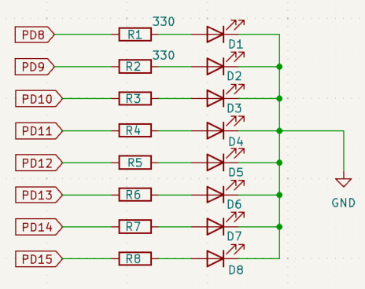


_Figure 1: Connecting_ 

### -  Declare additional variable LED_Value 


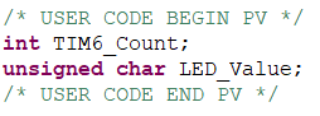


- Add the following void DisplayLEDs(int mode) function to main.c file at the appropriate location in the **_Private user code_** area. 

```
/* Private user code ------------------------------------------------*/
/* USER CODE BEGIN 0 */
voidDisplayLEDs(int mode)
{
if (mode == 1)
{
LED_Value = (LED_Value >> 1) | (LED_Value << 7);
}
if (LED_Value & 0x80)
HAL_GPIO_WritePin(GPIOD, GPIO_PIN_15, GPIO_PIN_SET);
else
HAL_GPIO_WritePin(GPIOD, GPIO_PIN_15, GPIO_PIN_RESET);
if (LED_Value & 0x40)
HAL_GPIO_WritePin(GPIOD, GPIO_PIN_14, GPIO_PIN_SET);
else
HAL_GPIO_WritePin(GPIOD, GPIO_PIN_14, GPIO_PIN_RESET);
if (LED_Value & 0x20)
HAL_GPIO_WritePin(GPIOD, GPIO_PIN_13, GPIO_PIN_SET);
else
HAL_GPIO_WritePin(GPIOD, GPIO_PIN_13, GPIO_PIN_RESET);
if (LED_Value & 0x10)
HAL_GPIO_WritePin(GPIOD, GPIO_PIN_12, GPIO_PIN_SET);
else
HAL_GPIO_WritePin(GPIOD, GPIO_PIN_12, GPIO_PIN_RESET);
if (LED_Value & 0x8)
HAL_GPIO_WritePin(GPIOD, GPIO_PIN_11, GPIO_PIN_SET);
else
HAL_GPIO_WritePin(GPIOD, GPIO_PIN_11, GPIO_PIN_RESET);
```

DCE-SOICT-HUST 

2 

<u>(Ver. 2026)</u> 

Embedded Systems IT4210E 

```
if (LED_Value & 0x4)
HAL_GPIO_WritePin(GPIOD, GPIO_PIN_10, GPIO_PIN_SET);
else
HAL_GPIO_WritePin(GPIOD, GPIO_PIN_10, GPIO_PIN_RESET);
if (LED_Value & 0x2)
HAL_GPIO_WritePin(GPIOD, GPIO_PIN_9, GPIO_PIN_SET);
else
HAL_GPIO_WritePin(GPIOD, GPIO_PIN_9, GPIO_PIN_RESET);
if (LED_Value & 0x1)
HAL_GPIO_WritePin(GPIOD, GPIO_PIN_8, GPIO_PIN_SET);
else
HAL_GPIO_WritePin(GPIOD, GPIO_PIN_8, GPIO_PIN_RESET);
}
```

- Use the **DisplayLEDs** function in the main loop to create a running LED effect 


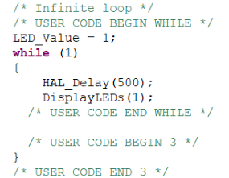


- Compile and upload the program to the kit. Correct any errors so that the circuit runs as in the video **Bai 1 - Nhay LED don.mp4.** 

### **_Self-Made Exercises:_** 

Write additional code for the DisplayLEDs function to create additional effects corresponding to the value parameter mode. 

- 1):  Running spot L: Turn on each LED from right to left 

   - ∘ ∘ ∘ ∘ ∘ ∘ ∘ ∘ → ∘ ∘ ∘ ∘ ∘ ∘ ∘ O    → ∘ ∘ ∘ ∘ ∘ ∘ O ∘ → ∘ ∘ ∘ ∘ ∘ O ∘ ∘ → ∘ ∘ ∘ ∘ O ∘ ∘ ∘ →     …...                  →     O ∘ ∘ ∘ ∘ ∘ ∘ ∘ → ∘ ∘ ∘ ∘ ∘ ∘ ∘ ∘ ∘ 

- 2):  Running spot R: Turn on each LED from left to right 

   - ∘ ∘ ∘ ∘ ∘ ∘ ∘ ∘ →     O ∘ ∘ ∘ ∘ ∘ ∘ ∘ → ∘ O ∘ ∘ ∘ ∘ ∘ ∘ → ∘ ∘ O ∘ ∘ ∘ ∘ ∘ → ∘ ∘ ∘ O ∘ ∘ ∘ ∘ →     …...                   → ∘ ∘ ∘ ∘ ∘ ∘ ∘ O     → ∘ ∘ ∘ ∘ ∘ ∘ ∘ ∘ ∘ 

3)  Flash: Turn on all 8 leds, delay appropriately then turn off all 8 leds. 

∘ ∘ ∘ ∘ ∘ ∘ ∘ ∘ →        O O O O O O O O  → ∘ ∘ ∘ ∘ ∘ ∘ ∘ ∘ 

4):  Spot bumber:  Turn on 2 LEDs symmetrically from outside to inside and from inside to outside 

∘ ∘ ∘ ∘ ∘ ∘ ∘ ∘ →     O ∘ ∘ ∘ ∘ ∘ ∘ O    → ∘ O ∘ ∘ ∘ ∘ O ∘ → ∘ ∘ O ∘ ∘ O ∘ ∘ → ∘ ∘ ∘ O O ∘ ∘ ∘ → ∘ ∘ ∘ O O ∘ ∘ ∘ → ∘ ∘ O ∘ ∘ O ∘ ∘ → ∘ O ∘ ∘ ∘ ∘ O ∘ → O ∘ ∘ ∘ ∘ ∘ ∘ O   → ∘ ∘ ∘ ∘ ∘ ∘ ∘ ∘ 

These effects are repeated 2 cycles before moving to the next effect in a circular manner. Students can choose the delay time when changing the light state. 

### **3.2. Connecting 7-segment LED** 

- Assemble the circuit to connect 2 7-segment LED modules with STM32F4 as shown in Figure 2. 

DCE-SOICT-HUST 

3 

<u>(Ver. 2026)</u> 

Embedded Systems IT4210E 

- 7-segment LED control pins connected to PE8-PE15. 

- The control pins select the LED module connected to PG2 and PG3. 


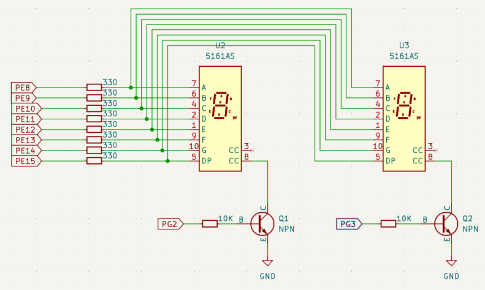


_Figure 2: Conecting 2 7-segment LED modules_ 

- Add the 7seg.h and 7seg.c files to the project. 

- Add code to main loop to display number 25 on 2 7-segment LED modules 

```
  /* USER CODE BEGIN 2 */
  HAL_TIM_Base_Start_IT(&htim6);
  Set7SegDisplayValue(25);
  /* USER CODE END 2 */
  /* Infinite loop */
  /* USER CODE BEGIN WHILE */
  LED_Value = 1;
  while (1)
  {
  HAL_Delay(5);
  DisplayLEDs(1);
  Run7SegDisplay();
    /* USER CODE END WHILE */
    /* USER CODE BEGIN 3 */
  }
```

- Compile and run program on kit STM32F429. Correct any errors so that the circuit displays the number 25 on 2 7-segment LED modules, while the single LED array flashes at high frequency.. 

### **_Self-Made Exercises:_** 

- Program so that each time button B1 is pressed, the value displayed on the 2 7-segment LED modules increases by one unit. 

### **3.3. Decoding infrared control signals** 

_a. Encoding infrared remote control signals according to the NEC protocol._ 

DCE-SOICT-HUST 

4 

<u>(Ver. 2026)</u> 

Embedded Systems IT4210E 


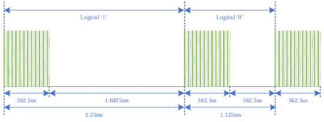


NEC’s infrared transmission protocol uses a “pulse distance encoding” method to encode bits 0 and 1. The infrared controller sends a series of infrared pulses modulated at 38 KHz called pulse bursts. Each pulse burst is 562.5 microseconds wide (blue area) and corresponds to 1 bit. The distance between the current pulse burst and the next pulse burst determines whether the bit value is 1 (long) or 0 (short). 

An NEC standard infrared command is a 32-bit binary string, packed into a message corresponding to 34 pulse bursts. 

- Start: 9ms wide burst, followed by 4.5ms silence. 

- 32 data bits, each bit is a 562.5 microsecond wide burst followed by 562.5 microsecond (bit 0) or 1687.5 microsecond (bit 1) silence. See appendix for more information. 

- Stop: 562.5 microsecond wide burst, marking the end of 32 bits 

- _b. Demodulation and decoding of infrared signals._ 


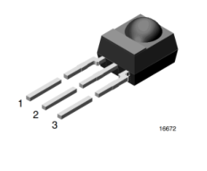


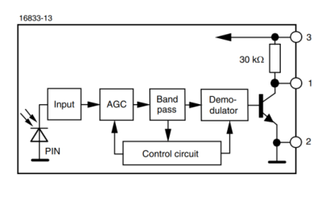


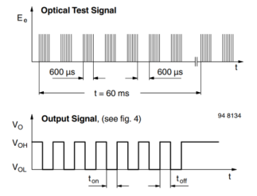


_Figure 3: Operating principle of HS0038 receiver_ 

Figure 3 describes the operating principle of the HS0038 infrared receiver and equivalent chips. In normal state, when the receiver does not detect a pulse bust, the logic value at the output at pin 1 is set to 1. When the receiver detects a pulse burst (emitted from the infrared control), the logic level at the output is 0. Thus, when a control command is sent to the receiver, there will be a corresponding pulse sequence at the receiver's output. This pulse sequence needs to be decoded to find the original command code value sent by the control. 

The principle of decoding infrared commands is based on the timing of the bits after demodulation. If the time of the corresponding bit is 13.5 ms, this is the start bit that starts a command. If the time is 1.25 ms, this is bit 0. And if the time is 2.25 ms, this is 

5 

DCE-SOICT-HUST 

<u>(Ver. 2026)</u> 

Embedded Systems IT4210E 

bit 1. A command will be decoded when it receives all 33 bits, including 1 start bit and 32 data bits. 

_c. Connecting and programming infrared message decoding.._ 

- Assemble the circuit connecting the HS0038 infrared receiver module to the STM32F429 according to the diagram. 

|Receiver Module|STM32F429|
|---|---|
|1|PG5|
|2|GND|
|3|3V|


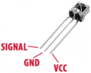


- Import the IrRemoteControl project in the corresponding zip file into STM32CubeIDE. 

- Compile and run on the kit. 

- Open Hercules software, open the Serial port in the Serial tab to observe the data sent from the kit to the PC via UART. Note: see the Serial port number in the PC's Device Manager. Every time a button on the remote is pressed, the corresponding command code of the button will appear on Hercules. 


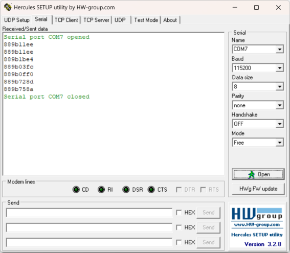


### **_Self-Made Exercises:_** 

- Read the project source code and describe in detail the method of decoding infrared control commands. 

   - The output pin of HS0038 is connected to pin PG5. Draw a graph of the signal value on pin PG5 over time when a button is pressed on the remote control (HS0038 receives a command from the remote control). 

   - Is the external interrupt EXTI5 on pin PG5 set to Rising edge or Falling edge? Why? 

   - How to measure the time of the bits? 

DCE-SOICT-HUST 

6 

<u>(Ver. 2026)</u> 

Embedded Systems IT4210E 

- What is the basis for determining the start bits, 0, 1? 

- When is a command from the remote control finished decoding? Where is the command code after decoding? 

### **4. Self-Made Exercises: Decoding infrared remote control commands** 

- Build a program to perform the following functions: 

   - + Decode the command sent from the remote control to the circuit. 

+ Display the button value (byte number 3 in the 4-byte command code series) on the 7-segment LED. 

- + If the command code corresponds to the OK button, turn on/off LED4. 

+ If the command code corresponds to one of the buttons 1, 2, 3, 4, display the corresponding effect on the single LED series. These effects were implemented in section 3.1. 

### **5. Writing report** 

- Explain the contents in section 3 and 4 (with images and source code).. 

**<u>Appendix</u>** <u>: Remote control command format and encoding according to NEC Protocol</u> 

# <mark>NEC Protocol</mark> 

NEC IR protocol encodes the keys using a 32-bit frame format as shown below. 

|NEC Frame Format||||
|---|---|---|---|
|Address|Complement of Address|Command|Complement of Command|
|LSB-MSB(0-7)|LSB-MSB(8-15)|LSB-MSB(16-23)|LSB-MSB(24-31)|


<mark>Each bit is transmitted using the pulse distance as shown in the image.</mark> **<mark>Logical '0':</mark>** <mark>A 562.5µs pulse burst followed by a 562.5µs space, with a total transmit time of 1.125ms</mark> 

**<mark>Logical ' 1 ':</mark>** <mark>A 562.5µs pulse burst followed by a 1.6875ms space, with a total transmit time of 2.25ms</mark> 


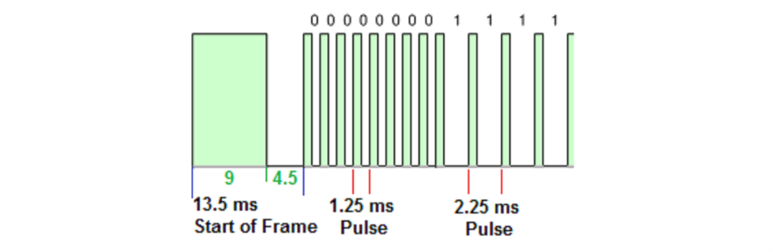


When a key is pressed on the remote controller, the message transmitted consists of the <mark>following, in order:</mark> 

DCE-SOICT-HUST 

7 

<u>(Ver. 2026)</u> 

Embedded Systems IT4210E 

<mark>1. A 9ms leading pulse burst (16 times the pulse burst length used for a logical data bit)</mark> 

2. A 4.5ms space 

3. The 8-bit address for the receiving device 

4. The 8-bit logical inverse of the address 

5. The 8-bit command 

6. The 8-bit logical inverse of the command 

7. A final 562.5µs pulse burst to signify the end of message transmission. 

<mark>The four bytes of data bits are each sent least significant bit first. Below image illustrates the format of an NEC IR transmission frame, for an address of 00h (00000000b) and a command of ADh (10101101b).</mark> 

A total of 67.5ms is required to transmit a message frame. It needs 27ms to transmit the 16 <mark>bits of address (address + inverse) and the 16 bits of command (command + inverse).</mark> 


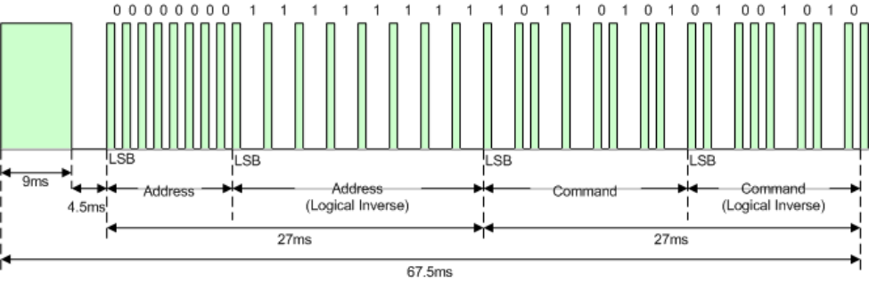


DCE-SOICT-HUST 

8 

