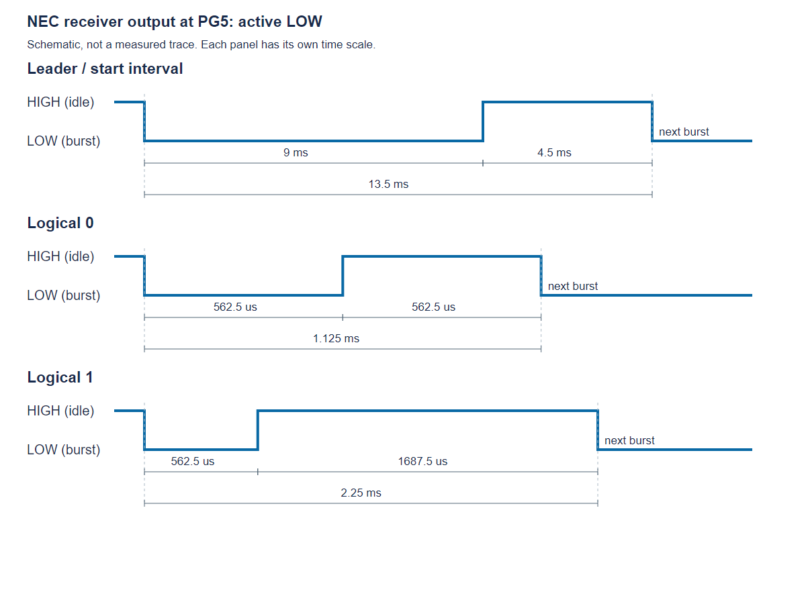

# LAB 1 REPORT — GPIO, SEVEN-SEGMENT DISPLAY AND IR DECODING

**Course:** Embedded Systems — IT4210E, semester 2026.1  
**Student:** Trần Anh Dũng  
**Student ID:** 20226031  
**Lab partner:** Maier Benedikt Quirin — **Student ID:** 20260015S  
**Scope:** Exercise 3.1 results, partial exercise 3.2 results, and exercise 3.3 source-based answers

## Declaration and acknowledgement

Declaration: The content and source code presented in this lab report were completed by me and my partner, Maier Benedikt Quirin. Any content or material referenced from external sources is acknowledged, including the original source and author.

The hardware experiment was carried out as a two-person group. This is my individual report of our shared work. The project is based on the sample and exercise requirements supplied by the instructor in *Lab1_IT4210E* (version 2026). The HAL and generated initialization code originate from STMicroelectronics. The group assembled the hardware, tested the firmware, and observed the LED behavior.

## 1. Objectives and completed work

Exercise 3.1 uses eight GPIO outputs to control eight individual LEDs. The objectives are to configure PD8–PD15 as outputs, represent the LED states using an eight-bit pattern, and implement four effects:

1. One illuminated spot moving along the LED row in one direction.
2. One illuminated spot moving in the opposite direction.
3. All eight LEDs flashing together.
4. Two symmetric illuminated spots moving from the outside toward the center and back outward.

Each effect is repeated twice before the next effect starts. The sequence runs continuously.

The class ended earlier than expected. Exercise 3.1 was completed. Exercise 3.2 reached a working three-segment test on two displays. For exercise 3.3, the independent-work questions are answered by analysing the supplied IrRemoteControl source; no IR hardware run or UART recording is claimed. Exercise 4 was not completed. This submission therefore distinguishes experimental results from source analysis and unfinished requirements.

## 2. Hardware and circuit

The experiment used an STM32F429 Discovery board, eight LEDs, eight series current-limiting resistors, a breadboard, jumper wires, and the board's ST-LINK USB connection. STM32CubeIDE 2.2.0 provided the compiler and build tools; STM32CubeProgrammer was used for programming and verification.

Each LED branch follows this connection:

```text
STM32 PD pin → series resistor → LED anode (+)
LED cathode (−) → common GND → STM32 GND
```

Each LED has its own resistor. All branches share the board ground. An output HIGH lights its LED; an output LOW turns it off.

| LED | GPIO | Pattern bit |
|---|---|---|
| LED1 | PD8 | 0 |
| LED2 | PD9 | 1 |
| LED3 | PD10 | 2 |
| LED4 | PD11 | 3 |
| LED5 | PD12 | 4 |
| LED6 | PD13 | 5 |
| LED7 | PD14 | 6 |
| LED8 | PD15 | 7 |

Physical left/right direction depends on how the board is viewed. Mode 1 traverses LED1 to LED8, and mode 2 reverses that order.

## 3. Added code and explanation

The relevant additions are in `Lab1_3_1/Core/Src/main.c`, inside the user-code sections. Clock initialization, HAL support, and the timer/button framework come from the supplied sample.

### 3.1 GPIO configuration

```c
/* Section 3.1 wiring test: PD8-PD15 each drive an LED through a resistor. */
  __HAL_RCC_GPIOD_CLK_ENABLE();
  HAL_GPIO_WritePin(GPIOD, (GPIO_PIN_8 | GPIO_PIN_9 | GPIO_PIN_10 | GPIO_PIN_11 | GPIO_PIN_12 | GPIO_PIN_13 | GPIO_PIN_14 | GPIO_PIN_15), GPIO_PIN_RESET);
  GPIO_InitStruct.Pin = (GPIO_PIN_8 | GPIO_PIN_9 | GPIO_PIN_10 | GPIO_PIN_11 | GPIO_PIN_12 | GPIO_PIN_13 | GPIO_PIN_14 | GPIO_PIN_15);
  GPIO_InitStruct.Mode = GPIO_MODE_OUTPUT_PP;
  GPIO_InitStruct.Pull = GPIO_NOPULL;
  GPIO_InitStruct.Speed = GPIO_SPEED_FREQ_LOW;
  HAL_GPIO_Init(GPIOD, &GPIO_InitStruct);
```

`__HAL_RCC_GPIOD_CLK_ENABLE()` enables the clock needed to operate GPIO port D. The initial write sets PD8–PD15 LOW, so the LEDs start off. The pins are configured as push-pull outputs, without internal pull-up or pull-down resistors. Low GPIO speed is sufficient because the animation changes only every 200 ms.

### 3.2 Pattern output and four effects

```c
/* Bit 0 controls PD8; bit 7 controls PD15. One frame lasts 200 ms. */
static void ShowLEDPattern(uint8_t pattern)
{
  uint32_t pins = ((uint32_t)pattern) << 8;
  GPIOD->BSRR = ((0xFF00U & ~pins) << 16) | pins;
  HAL_Delay(200);
}

/* Play one full cycle of the selected section 3.1 effect. */
void DisplayLEDs(int mode)
{
  static const uint8_t symmetric[] =
      {0x81, 0x42, 0x24, 0x18, 0x18, 0x24, 0x42, 0x81};

  ShowLEDPattern(0);
  switch (mode)
  {
    case 1:
      for (int bit = 0; bit < 8; bit++)
        ShowLEDPattern((uint8_t)(1U << bit));
      break;
    case 2:
      for (int bit = 7; bit >= 0; bit--)
        ShowLEDPattern((uint8_t)(1U << bit));
      break;
    case 3:
      ShowLEDPattern(0xFF);
      break;
    case 4:
      for (unsigned int step = 0; step < sizeof(symmetric); step++)
        ShowLEDPattern(symmetric[step]);
      break;
    default:
      break;
  }
  ShowLEDPattern(0);
}
```

#### Writing a pattern

`ShowLEDPattern()` receives an eight-bit pattern. A bit equal to 1 means its LED should be on; a bit equal to 0 means off. Shifting the pattern left by eight aligns bits 0–7 with port D pins 8–15.

`BSRR` is the GPIO bit set/reset register. Its lower half sets output pins HIGH; its upper half resets output pins LOW. The expression combines the two operations into one register write:

- `pins` sets the LEDs selected by the pattern.
- `0xFF00U & ~pins` selects the remaining LED pins to reset.
- Shifting the reset mask left by 16 places it in the reset half of BSRR.

The mask restricts the operation to PD8–PD15, leaving the other port D outputs unchanged. `HAL_Delay(200)` keeps each state visible for 200 ms.

#### Modes 1 and 2: moving spot

`1U << bit` creates a pattern with exactly one bit set. Mode 1 increases the bit index from 0 to 7, producing `01, 02, 04, 08, 10, 20, 40, 80` in hexadecimal. Mode 2 decreases the index from 7 to 0. Both effects begin and end with all LEDs off.

#### Mode 3: flash

`0xFF` sets all eight bits, so all LEDs turn on. The final `ShowLEDPattern(0)` switches them off. Repeating this mode twice produces two flashes.

#### Mode 4: symmetric motion

The pattern array controls symmetric pairs:

| Hex pattern | Illuminated LEDs |
|---|---|
| `81` | LED1 and LED8 |
| `42` | LED2 and LED7 |
| `24` | LED3 and LED6 |
| `18` | LED4 and LED5 |

The array then runs in reverse order. The center pattern is repeated, keeping the center pair illuminated for 400 ms before the outward movement. This follows the repeated center state shown in the lab guide.

### 3.3 Repetition and sequencing

The following code runs inside `while (1)`:

```c
for (int mode = 1; mode <= 4; mode++)
    {
      for (int cycle = 0; cycle < 2; cycle++)
        DisplayLEDs(mode);
      HAL_Delay(600);
    }
```

The outer `for` loop selects modes 1 through 4. The inner loop calls the selected mode twice. A further 600 ms delay separates effects. The surrounding infinite loop restarts the complete sequence.

Modes 1, 2, and 4 each take approximately 2 seconds per cycle: eight active states plus two blank states, each lasting 200 ms. Mode 3 takes approximately 0.6 seconds per cycle. Including the four transition delays, a complete sequence takes approximately 15.6 seconds, excluding small execution overhead.

The inherited TIM6 initialization remains in the project, but these LED animations use `HAL_Delay()`, which relies on the HAL time base. They do not use the TIM6 counter to schedule animation frames. The implementation is blocking, which is sufficient for this standalone LED exercise but would need revision if combined with a rapidly refreshed display.

## 4. Testing and experimental results

Testing started with one LED on PD8 blinking every half second. The LED initially remained dark; correcting its polarity resolved the issue. The circuit was expanded to two LEDs, then eight. The shared ground connection was also checked after changing the breadboard wiring. All eight LEDs were confirmed blinking in the wiring test before the four-effect firmware was programmed.

The four-effect firmware was built, programmed into the STM32, verified by the programmer, and started. The build completed with zero errors and zero warnings during the session. The program implements two cycles of each effect and continuous repetition. The linked recording is supplied as the experimental demonstration.

**Exercise 3.1 video:** [GPIO LED effects — Google Drive](https://drive.google.com/file/d/1Z9nfwkYHwPd9zVRoTPCs3DkIkT2w0YMb/view?usp=drive_link)

The recording is the evidence for the visible sequence. Its contents and sharing permissions were not independently checked during report preparation. Successful compilation and flash verification alone do not establish that every visual requirement appears in the video.

## 5. Exercise 3.2 — partial implementation and testing

### 5.1 Requirements and achieved scope

The guided task requires displaying 25 on two seven-segment displays, with the individual LED array operating. The self-made exercise adds one to the displayed number on each B1 press. Our separate project, `Lab1_3_2`, reached a preliminary wiring test; neither the complete 25 display nor the B1 counter was completed.

Two 5161AS common-cathode displays were used with P2N2222A NPN digit switches and 10 kohm base resistors. The eight segment resistors were reused from exercise 3.1 because extra resistors were unavailable. The old individual-LED outputs were disconnected during this work; simultaneous operation of that array is not claimed. One display was reported to have a faulty middle segment g. The tested segments a, b and c do not depend on g.

### 5.2 Wiring and output configuration

The intended segment outputs are PE8-PE15 for a, b, c, d, e, f, g and the decimal point. PG2 and PG3 control the two transistor bases through their resistors. Each transistor emitter returns to board GND and its collector connects to its display's common-cathode pins. Setting a digit control HIGH enables that display.

The displays were placed with the first at D5-D9/H5-H9 (decimal point nearest H5), and the second at D15-D19/H15-H19 (decimal point nearest H15). Corresponding segments share a resistor because only one digit is enabled at a time.

| Tested segment | GPIO | Series resistor | Display 1 connection | Display 2 connection |
|---|---|---|---|---|
| a | PE8 | B35-F35 | G35 to A6 | H35 to A16 |
| b | PE9 | B36-F36 | G36 to A5 | H36 to A15 |
| c | PE10 | B37-F37 | G37 to J6 | H37 to J16 |

GPIOE pins 8-15 are configured as push-pull outputs and initially reset. PG2 and PG3 are also initialized LOW as push-pull outputs, leaving both displays disabled until selected.

### 5.3 Added test code

The current test loop is:

```c
HAL_GPIO_WritePin(GPIOG, GPIO_PIN_2 | GPIO_PIN_3, GPIO_PIN_RESET);
    HAL_GPIO_WritePin(GPIOE, GPIO_PIN_8 | GPIO_PIN_9 | GPIO_PIN_10, GPIO_PIN_SET);
    HAL_GPIO_WritePin(GPIOG, GPIO_PIN_2, GPIO_PIN_SET);
    HAL_Delay(500);
    HAL_GPIO_WritePin(GPIOG, GPIO_PIN_2, GPIO_PIN_RESET);
    HAL_GPIO_WritePin(GPIOG, GPIO_PIN_3, GPIO_PIN_SET);
    HAL_Delay(500);
```

At the start of each iteration both digit switches are disabled. PE8, PE9 and PE10 are then set HIGH, corresponding to segments a, b and c, which form 7. PG2 enables display 1 for 500 ms; it is then disabled before PG3 enables display 2 for 500 ms. The loop repeats.

This slow alternation deliberately makes digit selection visible for troubleshooting. It is not the fast multiplexing needed to make both digits appear continuously illuminated. No B1 increment logic has been added. The supplied `7seg.h` and `7seg.c` were copied into the project but are not called by this test.

### 5.4 Results and remaining work

The circuit was tested first with segment a, then a/b, then a/b/c. Following wiring debugging, both displays were reported alternating correctly in the three-segment test. The saved build log records zero errors and zero warnings. No completed test of segment d or later segments is claimed. Remaining work includes wiring/testing the remaining segments, integrating the supplied display driver, fast digit scanning, displaying 25, and implementing a debounced B1 counter. There is no separate 3.2 demonstration video supplied with this report.

## 6. Exercise 3.3 — independent-work answers from source analysis

### 6.1 Read the project source code and describe in detail the method of decoding infrared control commands.

The HS0038 demodulates the infrared carrier into a digital envelope on PG5. The software measures intervals between falling edges rather than sampling the 38 kHz carrier. TIM6 generates periodic interrupts, each incrementing `tim6_count`. The PG5 interrupt handler calls `IrGetBitTime()` to save the elapsed count and reset it for the next interval.

The capture routine is:

```c
void IrGetBitTime()
{
	  if (tim6_count > 100)
	  {
		  bit_count = 0;
		  HAL_GPIO_WritePin(GPIOG, GPIO_PIN_14, GPIO_PIN_SET);
	  }

	  bit_time[bit_count] = tim6_count;
	  tim6_count = 0;
	  bit_count++;

	  if (bit_count == 33)
	  {
		  bit_count = 0;
		  HAL_GPIO_WritePin(GPIOG, GPIO_PIN_14, GPIO_PIN_RESET);
		  command_ok = 1;
	  }
}
```

An interval exceeding 100 ticks resets the index to zero. During a normal complete NEC frame, the 13.5 ms leader interval is about 135 ticks and is stored at index 0; the following 32 data intervals occupy indices 1-32. A long initial idle interval may also reset the index before the leader interval arrives. At 33 stored entries, `command_ok` is set. PG14 is used as a capture-state indicator.

The main loop checks `command_ok`, calls `IrDecode()`, prints the resulting four bytes through USART1, and clears the flag. The USART1 configuration is 115200 baud, 8 data bits, no parity, one stop bit; its TX/RX pins are PA9/PA10.

### 6.2 The output pin of HS0038 is connected to PG5. Draw a graph of the signal value on PG5 over time when a button is pressed on the remote control.

The receiver output is normally HIGH. During each detected infrared burst it becomes LOW. The following diagram is a schematic envelope, not drawn to scale and not an oscilloscope capture:



The figure shows the leader and both possible data-bit intervals in separate panels. Each falling-to-falling interval contains a LOW burst followed by a HIGH space. A full frame carries address, inverted address, command and inverted command, eight bits each, least significant bit first within each byte. A final 562.5 us LOW burst supplies the falling edge needed to complete the last data interval, after which the line returns HIGH.

### 6.3 Is the external interrupt EXTI5 on PG5 set to Rising edge or Falling edge? Why?

The source explicitly sets PG5 to `GPIO_MODE_IT_FALLING`, with `GPIO_PULLUP`, and enables `EXTI9_5_IRQn`. `EXTI9_5_IRQHandler()` calls `IrGetBitTime()` and then clears the PG5 interrupt through `HAL_GPIO_EXTI_IRQHandler(GPIO_PIN_5)`.

A falling edge marks the start of a received burst. Measuring from one falling edge to the next includes the burst and its following space, giving different durations for 0 and 1. Falling-edge intervals also identify the 13.5 ms leader. This describes the supplied implementation; other decoder designs could use different edge strategies.

### 6.4 How to measure the time of the bits?

The source configures SYSCLK to 180 MHz and APB1 to SYSCLK/4. With the configured APB1 prescaler, TIM6 receives a 90 MHz timer clock. Its prescaler is 89 and auto-reload period is 99:

```text
Interrupt frequency = 90,000,000 / ((89 + 1) * (99 + 1))
                    = 10,000 Hz
One tim6_count tick = 100 us = 0.1 ms
Elapsed time        ≈ saved count * 0.1 ms
```

Each TIM6 interrupt increments `tim6_count`. Each falling-edge interrupt stores the current count in `bit_time[bit_count]`, resets the count to zero, and advances the index. The resolution is therefore about 100 us, with interrupt timing also affecting the measurement.

### 6.5 What is the basis for determining the start bits, 0, and 1?

| Interval | Nominal time | Approximate ticks | Supplied code decision |
|---|---|---|---|
| Leader, falling edge to falling edge | 13.5 ms | 135 | More than 100 resets capture index |
| Data 0 | 1.125 ms | 11-12 | At most 20 decodes as 0 |
| Data 1 | 2.25 ms | 22-23 | More than 20 decodes as 1 |

The guide's explanatory paragraph gives 1.25 ms for a zero, but its appendix and constituent pulse lengths give 1.125 ms (562.5 + 562.5 us). The code separates data bits at 20 ticks, approximately 2 ms.

The greater-than-100 rule is a coarse synchronization threshold, not full validation of a NEC leader: an arbitrary long gap also satisfies it. The decoder does not check tight timing ranges or verify the address/command complement bytes, and this source does not implement a dedicated NEC held-button repeat-frame decoder.

### 6.6 When is a command from the remote control finished decoding? Where is the command code after decoding?

Capture is marked ready when `bit_count == 33`, covering one leader interval and 32 data intervals. At that point `command_ok = 1`; the four bytes have not yet been assembled. Actual byte decoding happens when the main loop calls:

```c
void IrDecode()
{
  unsigned char code;
  int bit, key, index = 0;
  for (key = 0; key < 4; key++)
  {
	  for (bit = 0; bit < 8; bit++)
	  {
		  code >>= 1;
		  index++;
		  if (bit_time[index] > 20)
			  code |= 0x80;
	  }
	  irda_cmd[key] = code;
  }
}
```

The function reads `bit_time[1]` through `bit_time[32]`. For each byte it shifts right and inserts a detected 1 into bit 7. After eight iterations this reconstructs the byte in the transmitted least-significant-bit-first order. Four decoded bytes are stored as:

| Variable | Meaning in a standard NEC frame |
|---|---|
| `irda_cmd[0]` | Address |
| `irda_cmd[1]` | Inverted address |
| `irda_cmd[2]` | Command/button byte |
| `irda_cmd[3]` | Inverted command |

The main loop formats these bytes with `%02x%02x%02x%02x`, transmits them on USART1, and clears `command_ok`. `bit_time[]` holds raw timing counts; `irda_cmd[]` holds the assembled code. These are distinct stages.

One code-quality limitation is that the local `code` variable is not initialized before its first right shift. It should be initialized explicitly before accumulating a byte. This observation comes from source inspection; the supplied program has not been modified or tested on IR hardware here.

## 7. Conclusion

Exercise 3.1 was completed using PD8–PD15 to control eight LEDs. The program uses bit patterns to generate moving, flashing, and symmetric effects, with two cycles per mode. The experiment also demonstrated why LED polarity, correct header selection, and a continuous ground return must be checked when an output does not light its LED.

Exercise 3.2 was partially tested, and exercise 3.3 was analysed from the supplied source. The complete exercise 3.2 counter, exercise 3.3 hardware experiment, and exercise 4 application remain unfinished.
